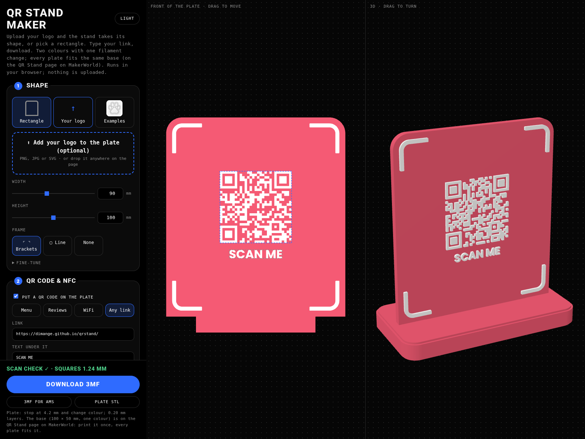
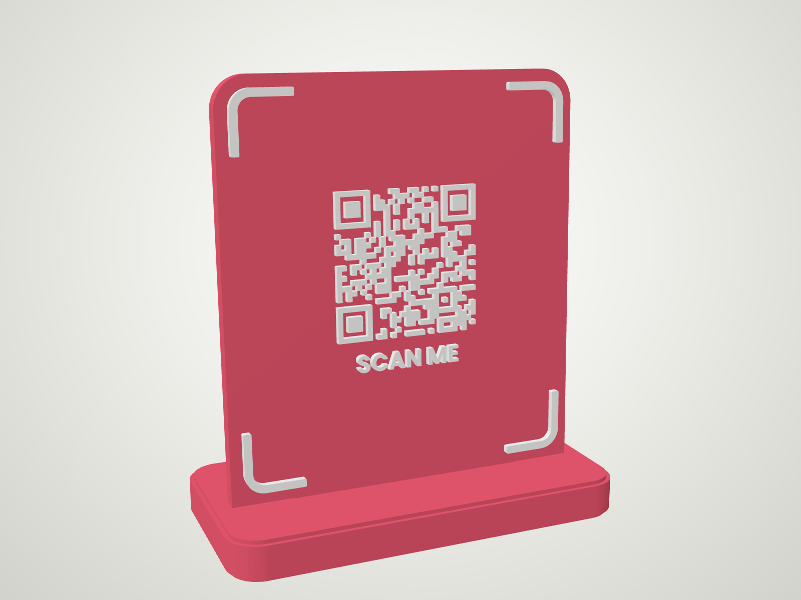
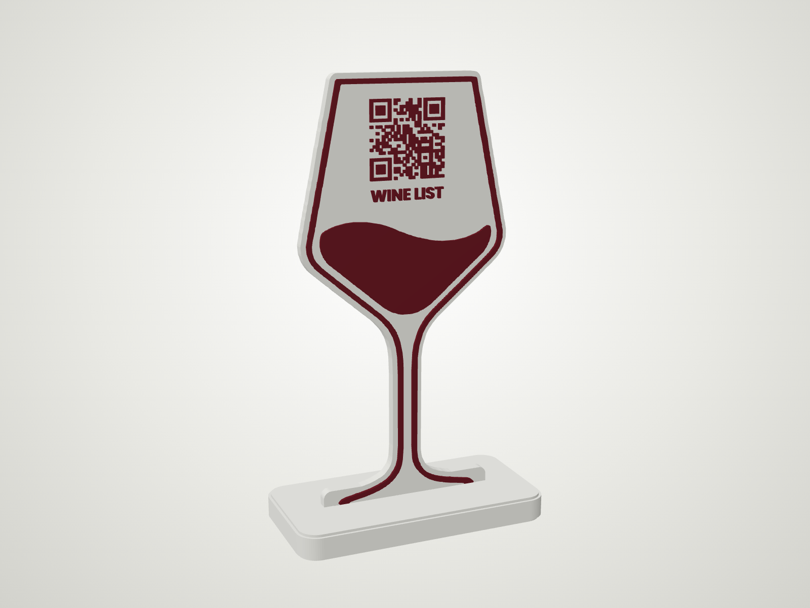
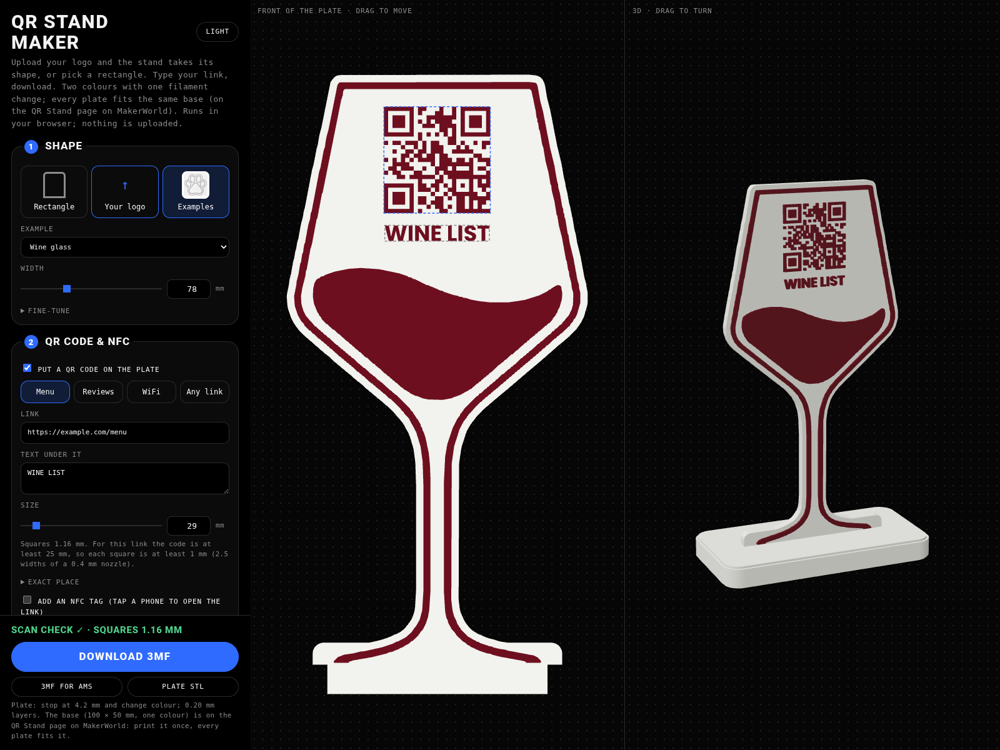

# QR Stand maker

Make a 3D-printed QR code stand in your browser: a rectangle, your own logo's outline, or a ready-made shape,
with your link, a line of text under the code and any words you like.

**Open it here: https://dimange.github.io/qrstand/**

## What it does

The stand is two parts: a **plate** that carries the QR code, and a small **base** it stands in. This page makes
the plate. It prints in **two colours on a single-filament printer**, with one pause and a filament swap at
4.2 mm. No AMS needed, though it works with one too.

The base is the same for every plate (100 × 50 × 10 mm, one colour). Download it once from the QR Stand page on
MakerWorld; every plate you make here fits it.

| Rectangle | Example shape: wine glass |
|---|---|
|  |  |

## How to use it

1. **Shape:** upload your own logo (PNG, JPG or SVG) and the plate takes its outline; or a rectangle (with a
   bracket, line or no frame); or one of the examples: robot, wine glass, paw.
2. **QR code:** pick Menu, Reviews, WiFi or Any link and type your link (or your WiFi name and password). Choose
   the text under the code and its size. The page checks that the code will scan once printed with a 0.4 mm
   nozzle, and refuses codes whose squares would be too small.
3. **NFC tag (optional):** tick *Add an NFC tag* and drag the circle where it should go. The plate gets a hidden
   pocket for a 25 mm round tag (NTAG213/215, up to 1.2 mm thick); the printer stops at 3.2 mm to drop it in.
   Write your link onto it afterwards with the free NFC Tools app.
4. **Your words:** add lines of text anywhere. Drag the code, its text and your words on the front view.
5. **Look:** font and the two colours, shown in the 3D preview and saved in the 3MF.
6. Download:

| Download | For | What you do |
|---|---|---|
| **Download 3MF** | Bambu printers without an AMS | Start with the body colour. The printer stops at 4.2 mm: swap to the detail colour, purge, resume. |
| **3MF for AMS** | Bambu printers with an AMS | Body colour in slot 1, detail colour in slot 2. The colour change at 4.2 mm is in the file. |
| **Plate STL** | Any other slicer | 0.20 mm layers, 3 walls, 5 top and 4 bottom layers, 15% infill, no supports. Add a pause or colour change at 4.2 mm yourself. |

The 3MF files carry a Bambu Lab A1 mini profile; on another Bambu printer pick yours when Bambu Studio asks and
keep the 0.20 mm layer height.

## Your files stay with you

Everything runs in your browser. Your logo and links are not uploaded anywhere, and the page loads nothing from
other sites.

## Good to know

- Plates stay under 170 × 170 mm, so they fit an A1 mini bed. A 0.4 mm nozzle is assumed.
- Simple, high-contrast logos work best.
- Test-scan the printed code with a phone before you put the stand out.

## For developers

Plain ES modules, no build step. Serve the folder with any static server (`python3 -m http.server`) and open it.
Geometry by manifold-3d, preview by three.js; see `vendor/LICENSES.md`.
